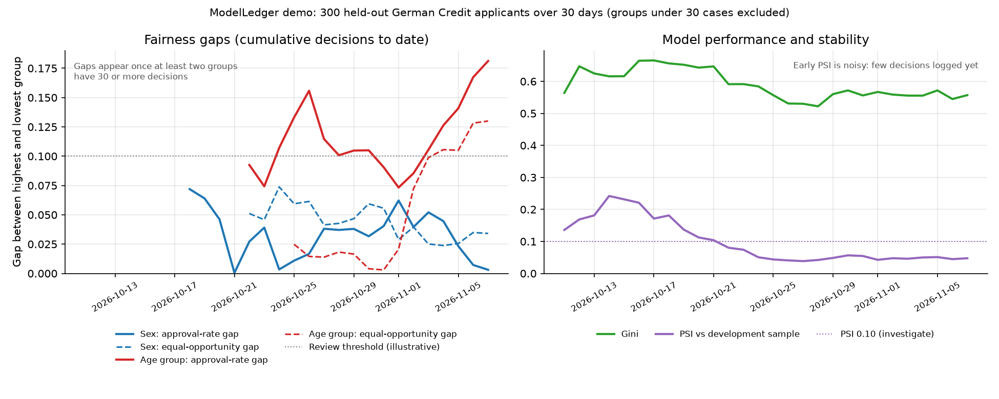

# ModelLedger

**A tamper-evident audit ledger and monitoring service for credit-decision models.**

Every credit decision a model makes is recorded with its inputs, score, SHAP
explanation and model version in a hash chain. Signed anchors make it possible
to detect edits even by someone with full database access. On top of the ledger,
ModelLedger tracks model performance (Gini, KS, PSI) and fairness across sex and
age groups, and produces a PDF evidence pack for model risk and validation reviewers.

It is a portfolio project built to explore one question from model risk
management: *how can a lender prove, months later, exactly what its model decided,
why, and whether the record has been changed?*



*Real output of the demo: 300 held-out German Credit applicants logged over 30
days. Left: approval-rate and equal-opportunity gaps between groups. Right: Gini
and PSI against the development sample.*

---

## What the demo shows

| | Result on 300 held-out applicants |
|---|---|
| Model discrimination | Gini 0.56 (AUC 0.78); 5-fold CV AUC 0.76 on the training set |
| Score stability | PSI 0.05 against the development sample (stable) |
| Approval-rate gap by sex | 0.003 (female 78.1%, male 78.4%) |
| Approval-rate gap by age group | **0.18** (18-25: 67.8%, 36-45: 85.9%), above the illustrative 0.10 review threshold |
| Equal-opportunity gap by age group | **0.13**: among applicants who went on to repay, 18-25s were approved 76% of the time against 89% for 36-45s |
| Integrity | All three tamper scenarios below are detected |

The age result is a genuine finding from the data, not a planted one: younger
applicants are approved less often, including younger applicants who went on to
repay, and the monitor flags both gaps for review. Whether
that is justified (age is linked to credit history length, for example) is a
question for the model owner, which is exactly the hand-off the tool is meant to
support.

---

## How tamper evidence works

1. **Hash chain.** Each decision's SHA-256 hash covers every stored field,
   including the sex and age-group fields used for fairness monitoring, plus the
   previous record's hash. Change anything and the chain breaks.
2. **Outcome events.** Repayment outcomes arrive later. They are never written
   back into the decision; each one is a new event in a second hash chain, so a
   corrected outcome leaves an audit trail.
3. **Signed anchors.** A hash chain alone needs no secret, so an insider could
   edit a record and recompute every later hash. Every 100 decisions, the service
   signs the current chain heads with an **Ed25519** private key and writes the
   signature to a file outside the database. Verification checks that the history
   up to each anchor still ends in the signed hash. Auditors need only the public
   key, which lets them verify but not forge.

| Attack | Command | Caught by |
|---|---|---|
| Edit a decision in SQL | `make attack-naive` | Decision chain |
| Edit a decision and recompute every hash | `make attack-recompute` | Signed anchors |
| Rewrite a repayment outcome | `make attack-outcome` | Outcome chain |
| Delete recent records | (tested) | Anchor record count |

**Limits, stated plainly**
- Decisions logged after the latest anchor are protected only by the hash chain
  until the next anchor is signed. A shorter interval narrows that window.
- Someone holding the private key *and* able to rewrite the anchor files could
  forge history. In production the key belongs in a KMS/HSM and the anchors on
  write-once storage controlled by a different team. This demo keeps both locally.

---

## Architecture

```
 applicant ─▶ credit-model service ──(Redis queue)──▶ worker ─▶ ledger (SQLite)
              XGBoost + SHAP                                     │  decisions chain
              returns decision                                   │  outcome chain
              immediately                                        │  signed anchors (files)
                                                                 ▼
                                   ModelLedger API: /verify /fairness /performance /report
```

The model service publishes each decision to a queue and returns straight away,
so the audit system is not on the decision path. The worker and the API both
write to the ledger; every append reads the chain head and inserts inside one
`BEGIN IMMEDIATE` transaction, so concurrent writers cannot fork the chain (there
is a multi-process test for this).

---

## The demo model

- **Data:** German Credit (OpenML `credit-g`, 1,000 applicants), stratified
  70/30 split. The ledger is seeded only with the 300 test applicants.
- **Model:** XGBoost (depth 3, 300 trees). Test AUC 0.78, Gini 0.56, accuracy
  75% against 70% for always predicting the majority class. Train AUC is 0.92,
  so there is some overfitting; CV and test AUC agree.
- **Excluded inputs:** `personal_status` (it encodes sex) and `foreign_worker`
  (a nationality proxy) are not model inputs. Sex is still recorded with each
  decision so outcomes can be monitored by group.
- **SHAP values** come from the trained model (TreeExplainer) and sum to the
  model's log-odds for each decision (tested).

**Demo simplification:** real repayment outcomes arrive months after a decision.
The seeder back-fills the dataset's known outcomes, so every daily snapshot can
use them.

---

## Regulatory context

ModelLedger produces evidence that can *support* these expectations. Software on
its own does not make a firm compliant with any of them.

| Framework | Relevant expectation | What ModelLedger provides |
|---|---|---|
| PRA SS1/23 (model risk management) | Model inventory, performance monitoring, independent validation | Model version and file hash on every decision; Gini/KS/PSI history; an evidence pack for validators. SS1/23 applies directly to banks with internal-model approval and is widely used as a benchmark by other lenders. |
| FCA Consumer Duty | Monitor outcomes, including for different groups of customers | Approval and equal-opportunity gaps by sex and age group, with history and alerts |
| Equality Act 2010 | Avoid direct and indirect discrimination (age and sex are protected characteristics) | Sex excluded from the model, outcomes still monitored by sex and age. The metrics are not a legal test. |
| EU AI Act Art. 12, 13, 72 | Logging, transparency, post-market monitoring for high-risk systems | Per-decision tamper-evident log with SHAP. Creditworthiness assessment is high-risk under Annex III; those obligations apply from 2 December 2027 after the Digital Omnibus delay, and only to firms within the Act's scope. |

On fairness metrics: approval-rate parity and equal opportunity can conflict when
groups have different repayment rates, and well-known results (Kleinberg et al.
2016; Chouldechova 2017) show that calibration and equal error rates cannot
generally all hold at once. Which gap to prioritise, and the 0.10 threshold, are
policy choices; the defaults here are illustrative. Groups with fewer than 30
cases are shown but left out of the gap.

---

## Quick start

Use Python 3.11 or later (developed on 3.11, also run on 3.14). Package versions are pinned; results can differ slightly between Python versions (the figures above come from Python 3.14).

```bash
python3.11 -m venv .venv && source .venv/bin/activate
pip install -r requirements.txt
cp .env.example .env
python scripts/generate_keys.py        # paste both lines into .env, and set MODELLEDGER_API_KEY

make train          # downloads German Credit from OpenML once, trains the model
make seed           # 300 decisions over 30 days, outcomes, anchors, daily snapshots
make attack-recompute   # optional: see the full-rewrite attack get caught
make charts         # assets/monitoring_history.png
make report         # PDF evidence pack in reports/
make test           # 45 tests
make run            # API on http://localhost:8000/docs
```

Docker (model service, Redis, worker, API): run `make train` and create `.env`
first, then `make demo-flow`.

## API

| Method | Endpoint | Purpose |
|---|---|---|
| GET | `/health` | Counts, last anchor, model version and hash (no auth) |
| POST | `/decisions` | Log a decision (rate-limited per API key) |
| GET | `/decisions/{id}` | A decision with its outcome events |
| PATCH | `/decisions/{id}/outcome` | Add an outcome event (never overwrites) |
| GET | `/verify` | Decision chain + outcome chain + every anchor; 409 if anything fails |
| GET / POST | `/anchors` | Verify anchors / sign one now |
| GET | `/fairness?group_by=sex\|age_group` | Fairness metrics (no side effects) |
| GET | `/performance` | Gini, KS, PSI |
| POST | `/monitoring/snapshot` | Store today's fairness and performance snapshot |
| POST | `/report`, GET `/reports/{id}` | Generate and download the PDF evidence pack |

All endpoints except `/health` need the `X-API-Key` header. The full spec is in
[docs/openapi.json](docs/openapi.json).

## Tests

45 tests, including regressions for every problem found in the earlier version:

- every stored field (including sex and age group) is covered by the hash
- the edit-and-recompute attack passes the chain but fails the anchors
- anchors stay valid as the ledger grows
- outcomes are events, and editing one is detected
- four processes writing at once still produce one intact chain
- the rate limit returns 429 once exceeded
- the PDF tables wrap and the report names PRA SS1/23 correctly

## Project structure

```
modelledger/
  core/          database.py (SQLite, atomic appends), fingerprinter.py (chains),
                 anchor.py (Ed25519 anchors)
  model/         credit_model.py (data, encoding, scoring, SHAP)
  fairness/      monitor.py
  monitoring/    performance.py (Gini, KS, PSI)
  compliance/    report.py (PDF evidence pack)
  api/           server.py (ModelLedger API), stub_credit_model.py (demo model service)
  worker.py      queue consumer
scripts/         train_model.py, seed_demo_data.py, generate_keys.py,
                 generate_charts.py, make_report.py, export_openapi.py
tests/           45 pytest tests
docs/            design_decisions.md, openapi.json
```

## What I would do next

- Move anchor signing to a cloud KMS and anchors to S3 Object Lock.
- Replace SQLite with PostgreSQL for multi-node deployments.
- Repeat the demo on a dated public dataset (for example Freddie Mac loan-level
  data) so performance can be monitored out-of-time.
- Add calibration-by-group checks alongside the approval-rate gaps.

## Licence

MIT, see [LICENSE](LICENSE).
